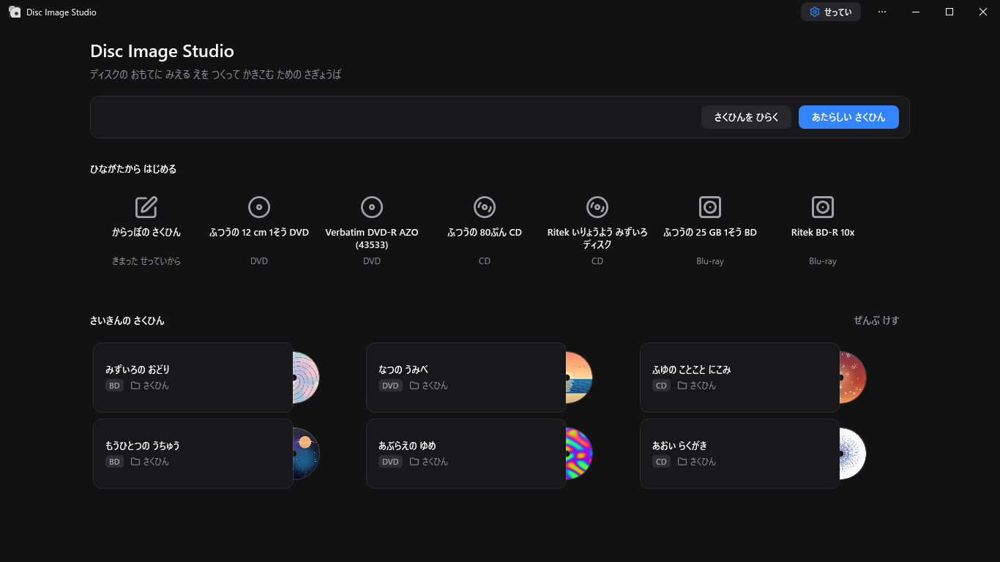
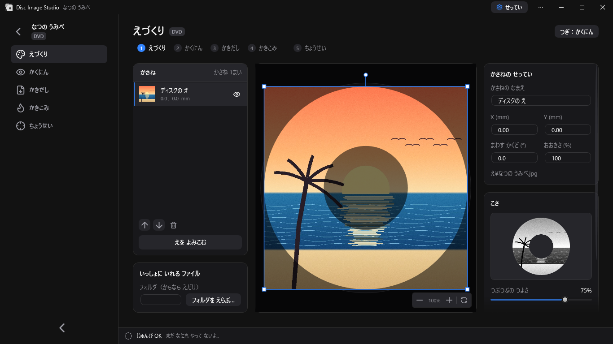
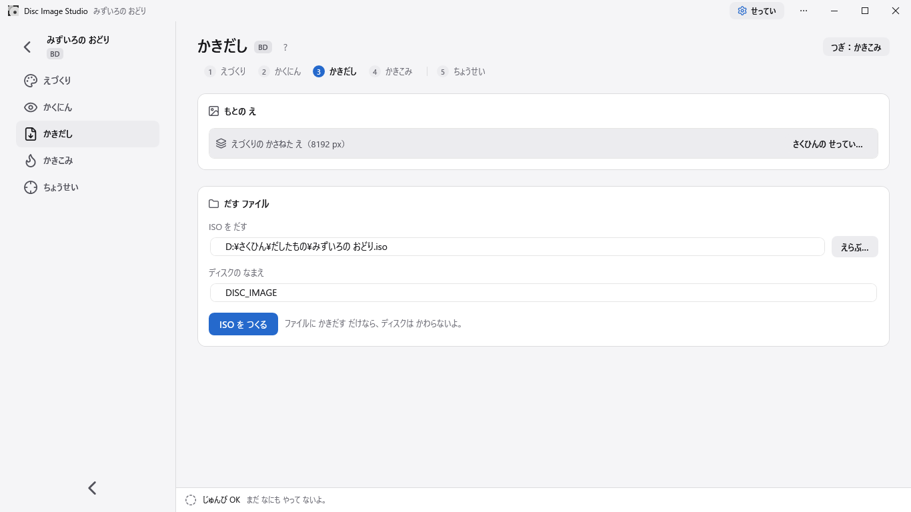

<div align="center">

[English](README.md) | [简体中文](README.zh-CN.md) | [繁體中文](README.zh-TW.md) | [日本語](README.ja.md) | **にほんご（ひらがな）**


<h2>ディスクの おもてに、めで みえる えを つくって かきこむ どうぐ</h2>

Disc Image Studio は、ディスクの おもてに えを つくって かきこむ、Windows ようの どうぐだよ。**どんな** かきこみ ドライブでも、**どんな** DVD / CD / Blu-ray ディスクにも、めで みえる えを きざめるよ。


[](LICENSE)

</div>

---

## できあがりの れい


---

## どんな アプリ？

Disc Image Studio は、1まいの えを、CD・DVD・1そうの BD-R の きまりに あった データに かえるよ。それを かきこむと、ディスクの おもてに めで みえる えが うかびあがるよ。

## ほんやくに ついて

この プロジェクトの ほんやくは v1.3.3 の ときに やったんだけど、この プロジェクトを みつけて はじめた 1じかん あとに v1.3.4 が でて、そっちにも ほんやくの しくみが はいった。
だから この べつばんは、いまと なっては ちょっと いみが なくなっちゃった。すこしは めんどうを みるけど、いまは だれでも JSON ファイルを ちょっと なおすだけで ほんやく できるよ。

## がめんの ようす







---

## はじめかた

[GitHub Releases](https://github.com/JiaFeiMiao-K-Cat/DiscImageStudio/releases) から EXE を もらってきて、ひらいたら そのまま うごかしてね。EXE には .NET の うごかす しくみも はいってるよ。

### 1. さくひんを つくる

さいしょの がめんで CD・DVD・Blu-ray を えらんで、だしさきを きめて、さくひんを つくる。

### 2. ディスクの えを かんがえる

「えづくり」で えを よみこんで、かさねで ならべる。みぎの「こさ」で、つぶつぶの つよさ、あかるさ、こさの だんかいの かず などを かえられるよ。

### 3. かくにんして かきだす

「かくにん」で ディスクに うつした ようすを みて、「かきだし」で ISO / RAW / WAV+CUE を つくるか、「そのまま かきこみ」で からっぽの ディスクに じかに かきこむ。

「そのまま かきこみ」は まだ ためしの きのうだから、だめに なっても いい ためしようの ディスクだけで つかってね。

## できる こと

### ディスクの データづくり

- **CD**：どんな CD でも つかえるよ。WAV の おとの トラックと、それに あう CUE ファイルを かきだせる。cdrecord や ImgBurn などの かきこみ アプリで つかえる かたちだよ。RAW の おとの トラックも かきだせる。くわしくは [CD の かきこみの あいしょう](docs/CD_AUDIO_COMPATIBILITY.md)（えいご）を みてね。
- **DVD**：どんな DVD でも つかえるよ。ISO ファイルを かきだせる。
- **Blu-ray**：1そう 25 GB の BD-R なら どれでも つかえるよ。えだけの ディスクも、UDF 2.01 の ファイル いりの ディスクも つくれる。くわしくは [ADDING_BLURAY.md](docs/ADDING_BLURAY.md)（えいご）を みてね。
- **いっしょに いれる ファイル**：CD / DVD / Blu-ray では、ディスクに いれる フォルダと、それを うちがわと そとがわの どちらに おくかを「えづくり」で えらべるよ。「かきだし」でも かえられて、せっていは さくひんに ほぞん されるよ。
- **ファイルの ところの みほん**：まぜた ディスクでは、「えの うつしこみ」と「できあがりの よみもどし」で、ファイルの ところを きいろで しめすよ。
- **ディスクの こさ**：CD と DVD は どちらも しろと くろの 2だんかいを つかうよ。CD は `0D / AA`、DVD は `A5 / 92` を つかう。くわしくは [PHYSICAL_MODEL_AUDIT.md](docs/PHYSICAL_MODEL_AUDIT.md)（えいご）を みてね。
- **つぶつぶ へんかんの どうぐ**：もとの えを、しろと くろ（`0/255`）だけの PNG に かえる、べつの ちいさな アプリだよ。くわしくは [つかいかたと つくりかた](tools/FourLevelDither/README.md)（えいご）を みてね。
- **ひながた**：いろんな かいしゃの ディスクの せっていが、さいしょから はいってるよ（CD / DVD / BD）。じぶんで ちょうせい した せっていを とどける ことも できる。[ひながたの せつめい](docs/DISC_PRESETS.md)（えいご）を みてね。

### ちょうせいの おてつだい

Disc Image Studio には、かしこくて こまかい「ちょうせいの おてつだい」が あるよ。めで みて あわせるより、ディスクの おおきさを ずっと こまかく（10<sup>-6</sup> から 10<sup>-14</sup> まで）わりだせる。ちょうせい まえは みぞの かんかくを いつも おなじと かんがえるので、じゅうじの うでが はっきり まがる。「ちょうせいの おてつだい」で だした せっていで つくりなおして かきこむと、うでは ずっと まっすぐに ちかづくよ。

| ちょうせい まえ・みぞの かんかくは いつも おなじ | ちょうせい あと・みぞの かんかくは 3じの しき |
| --- | --- |
|  |  |
| `P20261004-133519.jpg` | `P20261004-135416.jpg` |


やりかたと せっていは [ちょうせいの おてつだいの せつめい](docs/CALIBRATION.md)（えいご）に あるよ。

### かきこみ

- **ファイルで だす**：ISO / RAW ファイルを まるごと かきだして、あう かきこみ アプリで じぶんで かきこむ。
- **そのまま かきこみ（ためし）**：CD・DVD・BD-R は、まるごと ファイルを ほぞん せずに、つくりながら おなじ ときに かきこめるよ。
- **からっぽじゃ ない ディスクは つかわないでね！**

### アプリの しくみ

- いろんな ことば：みぎうえの「せってい」ボタンを おして、「きほん → ことば」で、English、ちゅうごくご（かんたいじ）、ちゅうごくご（はんたいじ）、にほんご、にほんご（ひらがな）、「Windowsに あわせる」から えらんで、ほぞん してから アプリを また ひらいてね。ことばと いろは さいしょは Windows に あわせて いて、じぶんで ほぞん した えらびは そのまま のこるよ。「Windowsに あわせる」だと、にほんごの Windows では かんじ ありの にほんごに なるよ。ひらがなの にほんごは、じぶんで えらんでね。
- いりぐちは 2つ：なにも つけずに ひらくと がめんが でて、うしろに ことばを つけて ひらくと、コマンドで うごく どうぐに なるよ。
- くみたて しき：CD・DVD・Blu-ray は `IOpticalDiscModule` で つながって いるよ。[しくみの せつめい](docs/ARCHITECTURE.md)（えいご）を みてね。

## うごかす のに ひつような もの

- Windows 10 2004（20H1、19041）いこう、または Windows 11。
- じぶんで つくる なら .NET 10 SDK が いるよ。くばってる EXE には ひつような ものが ぜんぶ はいってるから、.NET を べつに いれなくて いいよ。
- 「そのまま かきこみ」には、Windows が わかる CD / DVD / BD の かきこみ ドライブと、からっぽの ディスクが いるよ。BD-R は、じゅんばんに かきこめる 1そうの からっぽの ディスクが いるよ。

## じぶんで つくって うごかす

```powershell
dotnet build DiscImageStudio.slnx --configuration Release
dotnet run --project src/DiscImageStudio.App --configuration Release
```

こわれて いないか たしかめる テスト：

```powershell
dotnet run --project src/DvdImageSolver --configuration Release -- selftest
dotnet run --project tests/DiscImageStudio.ArchitectureTests --configuration Release
```

バージョンの きまりや くばりかたは [くばりかたの てびき](docs/RELEASING.md)（えいご）に あるよ。

## コマンドで うごかす

なにも つけずに ひらくと がめんが でて、コマンドを つけると じどうで うごく どうぐに なるよ：

| コマンド | すること |
| --- | --- |
| `solve` | きまった はやい やりかた（CW）で DVD の ファイルを つくる |
| `encode` | DVD の ECC の まとまりを 1つ、NRZI に かえる |
| `calibrate` | ちょうせいの うつしこみ：DVD の もとの えを、はかった おおきさで ディスクに うつす |
| `simulate` | はかった はんけいで、つくった DVD ISO の よみもどしを まねする |
| `selftest` | DVD の しくみが こわれて いないか じぶんで たしかめる |
| `cd-generate` | いっしょに いれる ファイルが なければ WAV + CUE / RAW の おとの トラックを、`--data-dir` を つけると CD データの ディスクの ISO を つくる |
| `cd-preview-warp` | ちょうせいの うつしこみ：はかった おおきさで CD の もとの えを うつす |
| `cd-preview-track` | いまある WAV か RAW の おとの トラックを、ちょうせいの おおきさで かく（よみもどしの まね） |
| `bd-generate` | BD-R の ISO を まるごと つくって、`<iso>.json` の sidecar も かく |
| `bd-info` / `bd-probe` / `bd-encode` | BD の せっていを みる、なかみを しらべる、ECC を 1つ しらべる |

くわしい つかいかたは、それぞれの せつめい（えいご）を みてね。

## プログラムの なかみ

```text
src/DiscImageStudio.Core/    ディスクの しゅるいに よらない きまりや、さくひん・ひながたの かたち
src/DiscImageStudio.Imaging/ CD/DVD/BD で つかう、えの したじゅんびと つぶつぶの てつだい
src/DiscImageStudio.Burning/ Windows の かきこみ ドライブを さがして、あんぜんに かきこむ ところ
src/DiscImageStudio.Cd/      CD の おとの トラックを つくる ところ
src/DiscImageStudio.Dvd/     DVD の しくみを つなぐ ところ
src/DiscImageStudio.BluRay/  BD-R の おおきさ、17PP/ECC、3T/6T、ISO づくり
src/DiscImageStudio.Iso/     UDF 2.01 / ISO9660 を かく ところ
src/DiscImageStudio.App/     WPF の がめんと コマンド
src/DvdImageSolver/          DVD の えを とく しくみ
tests/                       しくみが こわれて いないか たしかめる テスト
packaging/                   MSIX に まとめる ための もの
tools/                       べつの ちいさな どうぐ
docs/                        せつめいの しりょう（えいご）
```

## しりょう

| しりょう | なかみ |
| --- | --- |
| [ARCHITECTURE.md](docs/ARCHITECTURE.md) | しくみの わけかたと きまり |
| [LOCALIZATION.md](docs/LOCALIZATION.md) | がめんの ことばの せっていと、ほんやくの しかた |
| [DVD_ENGINE.md](docs/DVD_ENGINE.md) | DVD の えを とく しくみ |
| [CD_AUDIO_COMPATIBILITY.md](docs/CD_AUDIO_COMPATIBILITY.md) | CD の おとの トラックの かたちと、かげが でる ときの しらべかた |
| [ADDING_BLURAY.md](docs/ADDING_BLURAY.md) | Blu-ray の しくみと つくりかた |
| [DISC_PRESETS.md](docs/DISC_PRESETS.md) | なおせる ひながたの JSON の かきかた |
| [CALIBRATION.md](docs/CALIBRATION.md) | しゃしんの ゆがみなおし、せんの ちょうせい、DVD の みぞの かんかくの あてはめ |
| [PHYSICAL_MODEL_AUDIT.md](docs/PHYSICAL_MODEL_AUDIT.md) | CD / DVD の しくみの みなおし |
| [VALIDATION.md](docs/VALIDATION.md) | つくって ほんものの ディスクで ためした きろく |
| [RELEASING.md](docs/RELEASING.md) | GitHub での くばりかたと MSIX の つくりかた |
| [CHANGELOG.md](CHANGELOG.md) | バージョンごとの かわった ところ |

しりょうは えいごだけだよ。

## さんこうに した きかく

Disc Image Studio の つくりは、おもに つぎの きかくに したがって いるよ：

| ディスク | きかく | この プロジェクトで つかう ところ |
| --- | --- | --- |
| CD-R | [ECMA-394, 1st edition, December 2010](https://ecma-international.org/publications-and-standards/standards/ecma-394/) — *Recordable Compact Disc Systems CD-R Multi-Speed*（[PDF](https://ecma-international.org/wp-content/uploads/ECMA-394_1st_edition_december_2010.pdf)） | CD-R と、CD-DA の おとの トラック |
| DVD / DVD-ROM | [ECMA-267, 3rd edition, April 2001](https://ecma-international.org/publications-and-standards/standards/ecma-267/) — *120 mm DVD – Read-only disk*（[PDF](https://ecma-international.org/wp-content/uploads/ECMA-267_3rd_edition_april_2001.pdf)） | DVD の データの かたち、ECC、EFMPlus |
| DVD-R | [ECMA-359, 1st edition, December 2004](https://ecma-international.org/publications-and-standards/standards/ecma-359/) — *80 mm (1,46 Gbytes per side) and 120 mm (4,70 Gbytes per side) DVD Recordable Disk (DVD-R)*（[PDF](https://ecma-international.org/wp-content/uploads/ECMA-359_1st_edition_december_2004.pdf)） | 1そうの DVD-R の おおきさ、セクタ、まちがい なおし |
| BD-R | [ISO/IEC 30190:2021, 3rd edition, January 2021](https://www.iso.org/standard/80770.html) — 120 mm の かきこめる BD の きかく | 1そう 25 GB の しくみ（2そうは まだ つかえない） |

CD の かきかたは [ECMA-130, 2nd edition (CD-ROM, 1996)](https://ecma-international.org/publications-and-standards/standards/ecma-130/) にも したがって いるよ。

## かきこみと ディスクの あんぜん

- Disc Image Studio は、よけいな ものを パソコンに なにも いれないよ。「そのまま かきこみ」は Windows に はいってる IMAPI2 を つかって、からっぽじゃ ない ディスクは うけつけないよ。
- 「そのまま かきこみ」は まだ ためしの きのうだよ。だめに なっても いい ディスクだけで つかってね。とちゅうで とめたり、でんきが きれたり、つくるのが おそかったり すると、ディスクが だめに なる ことが あるよ！
- みえかたは、ディスク、ドライブ、かきこみかたで かわるよ。
- まぜた ディスクの フォルダは、かきこみの まえに なかみを しらべて ならびを きめるよ。そのあいだに ファイルの おおきさが かわると あんぜんに とまるけど、かきこみが はじまった ディスクは だめに なる ことが あるよ。
- BD-R は、とちゅうで とまったら、ふつうは おなじ ディスクに もう かきこめないよ。

## ひみつと あんぜん

- Disc Image Studio は インターネットに つながらないし、ファイルを おくったり、つかいかたを あつめたりも しないよ。[ひみつの きまり](PRIVACY.md)（えいご）を みてね。
- あんぜんの もんだいを みつけたら、みんなが みられる Issue には かかないでね。[あんぜんの きまり](SECURITY.md)（えいご）の とおり、GitHub の ないしょの しらせかたを つかってね。

## いっしょに つくる

こまった ことの しらせや、プログラムの てつだいは だいかんげい。くわしくは [てつだいかたの てびき](CONTRIBUTING.md)（えいご）を みてね。

## つかう ための きまり

この プロジェクトは [GNU GPL v3.0 or later](LICENSE)（`GPL-3.0-or-later`）で だして いるよ。CD の ならべかえの しくみには、CDImage から もってきて なおした コードが はいって いるので、ぜんたいも おなじ GPL の きまりに したがうよ。ほかの ひとの フォントや ぶひんは、それぞれの きまりの ままだよ。くわしくは [きまりの せつめい](LICENSE-NOTICE.md)（えいご）と [ほかの ひとの ぶひんの おしらせ](THIRD-PARTY-NOTICES.txt) を みてね。アプリの「この アプリに ついて」でも ぜんぶ よめるよ。

## おれい

[arduinocelentano さんの CDImage](https://github.com/arduinocelentano/cdimage) に ありがとう。CD の おとの トラックを つくって、ディスクの おもてに みえる えを かく やりかたを みせて くれたよ。この プロジェクトの CD の ならべかえの しくみは、そこの コードを もってきて なおした もので、CD に えを かく かんがえも そこから うまれたよ。CDImage を つくった ひとと、てつだった ひとたちの しごとが、この プロジェクトの だいじな どだいに なって いるよ。

---
