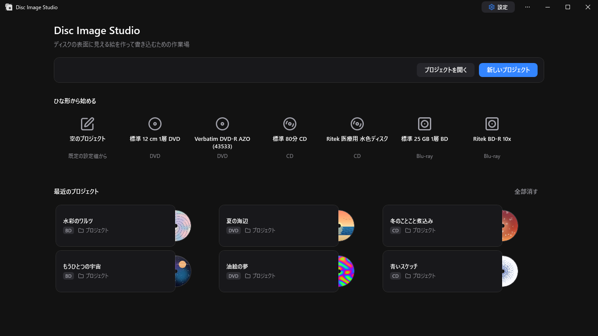
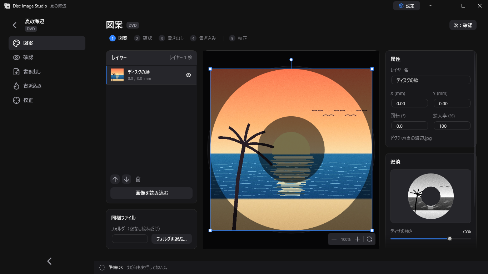
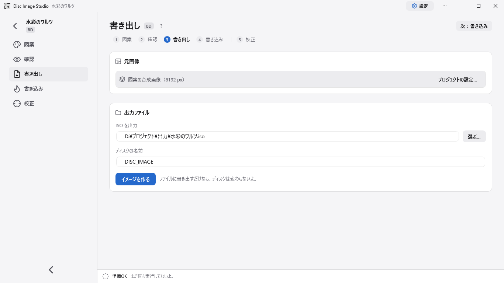

<div align="center">

[English](README.md) | [简体中文](README.zh-CN.md) | [繁體中文](README.zh-TW.md) | **日本語** | [にほんご（ひらがな）](README.ja-Hira.md)


<h2>ディスクの表面に、目に見える絵を作って書き込むためのツール</h2>

Disc Image Studio は、ディスクの表面に絵を作って書き込むための Windows 用ツール。**どんな**書き込みドライブでも、**どんな** DVD / CD / Blu-ray ディスクにも、目で見える絵を刻める。


[](LICENSE)

</div>

---

## 作例


---

## 概要

Disc Image Studio は、1 枚の画像を CD・DVD・1 層 BD-R の物理層の制約に合ったデータに変える。それを書き込むと、ディスクの表面に目で見える絵が浮かび上がる。

## 翻訳について

このプロジェクトの翻訳は v1.3.3 の時点でやったんだけど、このプロジェクトを見つけて作業を始めた 1 時間後に v1.3.4 が出て、そっちにも翻訳の仕組みが入った。
だからこのフォークは、今となってはちょっと意味がなくなっちゃった。少しはメンテするけど、今は誰でも JSON ファイルをちょっと編集するだけで翻訳できる。

## 画面







---

## はじめかた

[GitHub Releases](https://github.com/JiaFeiMiao-K-Cat/DiscImageStudio/releases) からリリース版の EXE をダウンロードして、展開したらそのまま起動する。EXE には .NET ランタイムが入っている。

### 1. プロジェクトを作る

最初の画面で CD・DVD・Blu-ray のどれかを選び、出力先を決めてプロジェクトを作る。

### 2. 盤面をデザインする

「図案」で画像を読み込み、レイヤーで並べる。右の「濃淡」でディザの強さ、ガンマ、明るさ、階調の数を調整する。

### 3. 確認して書き出す

「確認」でディスクへの投影を見て、「書き出し」で ISO / RAW / WAV+CUE を作るか、直接書き込みで空のディスクにそのまま書き込む。

直接書き込みは試験的な機能なので、ダメになってもいいテスト用のディスクだけで使うこと。

## 機能

### ディスクのデータ生成

- **CD 対応**：どんな CD でも使える。形式ヘッダー付きの WAV 音声トラックと、対応する CUE シートを書き出せる。cdrecord や ImgBurn などの書き込みソフトで使える形式だ。RAW 音声トラックの書き出しにも対応している。くわしくは [CD 書き込みの互換性](docs/CD_AUDIO_COMPATIBILITY.md)を参照。
- **DVD 対応**：どんな DVD でも使える。ISO イメージを書き出せる。
- **Blu-ray 対応**：1 層 25 GB の BD-R ならどれでも使える。絵だけのディスクも、UDF 2.01 のファイル入りのディスクも作れる。くわしくは [ADDING_BLURAY.md](docs/ADDING_BLURAY.md) を参照。
- **同梱ファイル**：CD / DVD / Blu-ray では、ディスクに入れるフォルダと、それを内周と外周のどちらに置くかを「図案」で選べる。「書き出し」でも変えられて、設定はプロジェクトに保存される。
- **ファイル領域のプレビュー**：混合ディスクでは、「図案の投影」と「完成品の読み戻し」でファイル領域（ファイルシステムを含む）を黄色で示す。
- **ディスクの階調**：CD と DVD はどちらも白黒 2 階調を使う。CD は `0D / AA`、DVD はスクランブル後の値で `A5 / 92` を使う。くわしくは [PHYSICAL_MODEL_AUDIT.md](docs/PHYSICAL_MODEL_AUDIT.md) を参照。
- **ディザ変換ツール**：元画像を `0/255` の白黒 2 階調 PNG に変換する単体のプログラム。元画像を開くかドラッグで入れて、並べてプレビューし、劣化なしの PNG で書き出せる。くわしくは[使い方とビルド方法](tools/FourLevelDither/README.md)を参照。
- **ディスクのプリセット**：いくつかのメーカーのディスク用の値が最初から入っていて、CD / DVD / BD をカバーしている。自分で校正した値を提供することもできる。[プリセットの管理方法](docs/DISC_PRESETS.md)を参照。

### 校正の手伝い

Disc Image Studio には、かしこくて精密な「校正の手伝い」がある。目で見て合わせる校正にくらべて、割り出せるディスクの物理パラメーターの精度が 10<sup>-6</sup> から 10<sup>-14</sup> まで上がる。校正前はトラック間隔を一定と見なすので、十字の放射状の腕がはっきり曲がる。「校正の手伝い」で求めた三次式のトラック間隔で作りなおして書き込むと、腕はずっとまっすぐな放射線に近づく。

| 校正前・トラック間隔は一定 | 校正後・トラック間隔は三次式 |
| --- | --- |
|  |  |
| `P20261004-133519.jpg` | `P20261004-135416.jpg` |


流れと設定値は[校正の手伝いの説明](docs/CALIBRATION.md)にまとめてある。

### 書き込み

- **イメージファイルの出力**：ISO / RAW ファイルを丸ごと書き出して、合った書き込みソフトで手動で書き込む。
- **直接書き込み（試験的）**：CD・DVD・BD-R は、イメージを丸ごと保存せずに、作りながら同時に書き込める。BD-R は MMC のシーケンシャル書き込みを使う。
- **空じゃないディスクは使わないこと！**

### アプリのしくみ

- 多言語の画面：右上の「設定」ボタンを押して「全般 → 言語」で English、简体中文、繁體中文、日本語、にほんご（ひらがな）（ひらがなだけの日本語）、「Windowsに合わせる」から選び、保存してアプリを再起動する。言語と配色はどちらも最初は Windows に合わせていて、自分で保存した選択はそのまま残る。「Windowsに合わせる」だと、繁体字の地域（`zh-TW`、`zh-HK`、`zh-MO`、`zh-Hant`）は繁体字、ほかの中国語は簡体字、日本語の Windows は日本語、それ以外は English になる。
- 入口は 2 つ：引数なしで起動すると画面が開き、引数を付けると共通のコマンドラインとして動く。
- モジュール式：CD・DVD・Blu-ray は `IOpticalDiscModule` でつながっていて、コマンドの一覧と作業の取り決めを共有している。[アーキテクチャの説明](docs/ARCHITECTURE.md)を参照。

## 動作環境と必要なもの

- Windows 10 2004（20H1、ビルド 19041）以降、または Windows 11。
- ビルド：.NET 10 SDK（`global.json` で 10.0.x に固定）。自分でビルドしたフレームワーク依存の画面版には .NET 10 Windows Desktop Runtime が必要。リリース版の EXE にはランタイムが入っているので、.NET を別に入れる必要はない。
- 直接書き込みには、Windows が認識する CD / DVD / BD の書き込みドライブと空のディスクが必要。BD-R はシーケンシャル記録に対応した 1 層の空のディスクが必要。

## ビルドと実行

```powershell
dotnet build DiscImageStudio.slnx --configuration Release
dotnet run --project src/DiscImageStudio.App --configuration Release
```

ビルドの回帰チェック：

```powershell
dotnet run --project src/DvdImageSolver --configuration Release -- selftest
dotnet run --project tests/DiscImageStudio.ArchitectureTests --configuration Release
```

バージョンの決まり、CI での EXE ビルド、リリース下書きのチェック、MSIX のパッケージ化と署名の流れは[リリースの手引き](docs/RELEASING.md)にある。

## コマンドライン

共通のプログラムは、引数なしだと画面を開き、引数があると自動化ツールとして動く：

| コマンド | 説明 |
| --- | --- |
| `solve` | 固定の高速テクスチャ表（CW）で DVD イメージを作る。白黒の質感のためにディザを混ぜることもできる |
| `encode` | DVD の ECC ブロック 1 つを NRZI のチャネルレベルに符号化する |
| `calibrate` | 校正の投影：生成時の寸法で DVD の元画像を読み取り、実測の寸法でディスクに映す |
| `simulate` | 実測の半径を使って、生成した DVD ISO の読み戻しを再現する |
| `selftest` | DVD エンジンの決定的な回帰セルフテストを実行する |
| `cd-generate` | 同梱ファイルがなければ WAV + CUE / RAW の音声トラックを、`--data-dir` を指定すると CD データディスクの ISO を作る |
| `cd-preview-warp` | 校正の投影：実測の寸法で CD の元画像を映す |
| `cd-preview-track` | 既存の WAV か RAW の CD-DA 音声トラックを校正の寸法で描く（読み戻しの再現） |
| `bd-generate` | BD-R の ISO を丸ごと作り、`<iso>.json` の sidecar を書く |
| `bd-info` / `bd-probe` / `bd-encode` | BD のパラメーターを出力、生のペイロードを調査、または ECC クラスタ 1 つを診断する |

各コマンドのくわしい引数は、それぞれのドキュメントを参照。

## ソースの構成

```text
src/DiscImageStudio.Core/    ディスクの種類によらないモジュールの取り決め、プロジェクト／プリセットのモデル、作業とコマンドの一覧
src/DiscImageStudio.Imaging/ CD/DVD/BD で共有する画像の前処理とディザの補助
src/DiscImageStudio.Burning/ Windows IMAPI2 のデバイス列挙、ストリームのバッファ、安全な書き込み層
src/DiscImageStudio.Cd/      CD-DA 生成の中心部分と CD モジュール
src/DiscImageStudio.Dvd/     DVD エンジンをつなぐモジュール
src/DiscImageStudio.BluRay/  BD-R の寸法、17PP/ECC、3T/6T の割り当て、ストリーム生成と ISO
src/DiscImageStudio.Iso/     UDF 2.01 / ISO9660 の書き出し
src/DiscImageStudio.App/     WPF の画面、共通のコマンドライン、ストア用の素材
src/DvdImageSolver/          独立した DVD の符号化／求解エンジン
tests/                       外部のテストフレームワークを使わないアーキテクチャ回帰テスト
packaging/                   MSIX のマニフェストとパッケージ化スクリプト
tools/                       単体の補助ツールと素材生成スクリプト
docs/                        アーキテクチャ、エンジン、プリセット、リリースのドキュメント
```

## ドキュメント

| ドキュメント | 内容 |
| --- | --- |
| [ARCHITECTURE.md](docs/ARCHITECTURE.md) | モジュールの抽象化、層の境界、拡張の決まり |
| [LOCALIZATION.md](docs/LOCALIZATION.md) | 画面の言語設定、システム言語への合わせ方、翻訳リソースの管理 |
| [DVD_ENGINE.md](docs/DVD_ENGINE.md) | DVD NRZI 画像制約ソルバーの取り決め、符号化の流れ、セルフテストの範囲 |
| [CD_AUDIO_COMPATIBILITY.md](docs/CD_AUDIO_COMPATIBILITY.md) | CD 音声トラックの形式、バイト順、ゴーストの調べ方 |
| [ADDING_BLURAY.md](docs/ADDING_BLURAY.md) | Blu-ray モジュールの物理モデル、生成／書き込みの流れ、拡張ポイント |
| [DISC_PRESETS.md](docs/DISC_PRESETS.md) | 編集できるディスクプリセットの階層 JSON 形式とマージの決まり |
| [CALIBRATION.md](docs/CALIBRATION.md) | 写真の補正（ディスク本体の外側の縁と中心の穴の縁をなぞる）、曲線の校正、DVD の三次式トラック間隔の当てはめ |
| [PHYSICAL_MODEL_AUDIT.md](docs/PHYSICAL_MODEL_AUDIT.md) | CD / DVD 生成の物理モデルの見直し |
| [VALIDATION.md](docs/VALIDATION.md) | ビルド、回帰、実際のディスクでのテストの各回のローカル検証記録 |
| [RELEASING.md](docs/RELEASING.md) | GitHub Release、MSIX のパッケージ化、署名テスト、ストア提出の流れ |
| [CHANGELOG.md](CHANGELOG.md) | バージョンごとの変更記録 |

ドキュメントは英語だけ。

## 参照した規格

Disc Image Studio の実装と物理モデルは、主に次の仕様にしたがっている：

| ディスク | 規格と版 | このプロジェクトで使う範囲 |
| --- | --- | --- |
| CD-R | [ECMA-394, 1st edition, December 2010](https://ecma-international.org/publications-and-standards/standards/ecma-394/) — *Recordable Compact Disc Systems CD-R Multi-Speed*（[公式 PDF](https://ecma-international.org/wp-content/uploads/ECMA-394_1st_edition_december_2010.pdf)） | CD-R メディア、複数速度での記録、CD-DA との互換性。このプロジェクトは CD-DA の音声トラックを作る。 |
| DVD 共通形式 / DVD-ROM | [ECMA-267, 3rd edition, April 2001](https://ecma-international.org/publications-and-standards/standards/ecma-267/) — *120 mm DVD – Read-only disk*（[公式 PDF](https://ecma-international.org/wp-content/uploads/ECMA-267_3rd_edition_april_2001.pdf)） | DVD のデータフレーム、ECC、EFMPlus 符号化、付属書 G の変換表。記録型ディスクのメディアの決まりは ECMA-359 にしたがう。 |
| DVD-R | [ECMA-359, 1st edition, December 2004](https://ecma-international.org/publications-and-standards/standards/ecma-359/) — *80 mm (1,46 Gbytes per side) and 120 mm (4,70 Gbytes per side) DVD Recordable Disk (DVD-R)*（[公式 PDF](https://ecma-international.org/wp-content/uploads/ECMA-359_1st_edition_december_2004.pdf)） | 1 層 DVD-R の寸法、セクタ、誤り訂正、符号化。この規格は片面と両面のメディアを扱うが、両面は 2 層とは別物。 |
| BD-R | [ISO/IEC 30190:2021, 3rd edition, January 2021](https://www.iso.org/standard/80770.html) — 120 mm の 1 層（25.0 GB）と 2 層（50.0 GB）の記録型 BD の情報交換と保存の仕様 | 試験的なモードで、1 層 25 GB のトラック、セクタ配置、誤り訂正、符号化を使う。2 層ディスクにはまだ対応していない。 |

CD の共通の符号化は [ECMA-130, 2nd edition (CD-ROM, 1996)](https://ecma-international.org/publications-and-standards/standards/ecma-130/) にもしたがっている。

## 書き込みとディスクの安全

- Disc Image Studio はドライバーやサービスを一切インストールしない。直接書き込みは Windows に入っている IMAPI2 を使い、空じゃないディスクは受け付けない。
- 直接書き込みは実際のディスクでの報告もあるけど、デバイス、メディア、書き込み方法の組み合わせではまだ確認の範囲がせまいので、試験的な機能だ。ダメになってもいいテスト用のディスクだけで使うこと。書き込み中の中断、停電、生成の遅れで、ディスクがダメになることはまだある！
- 見える仕上がりは、ディスク、ドライブ、ファームウェア、書き込み方式で変わる。
- 混合ディスクのフォルダは、書き込みを始める前に中身を調べて配置を決める。そのあいだに元のファイルのサイズが変わると作業は安全に止まるけど、書き込みが始まったディスクはダメになることがある。
- BD-R のシーケンシャル書き込みには、予備領域への置きかえがない。中断したら、同じディスクにはふつうもう書き込めない。

## プライバシーとセキュリティ

- Disc Image Studio はネットにつながらず、ファイルをアップロードせず、利用データも集めない。[プライバシーポリシー](PRIVACY.md)を参照。
- セキュリティの問題を見つけたら、公開の Issue には書かないで。[セキュリティポリシー](SECURITY.md)にあるとおり、GitHub の非公開の報告を使ってね。

## 貢献

不具合の報告やコードの貢献は大歓迎。準備、モジュールの境界の決まり、テストの条件、Pull Request の流れは[貢献の手引き](CONTRIBUTING.md)にある。

## ライセンス

このプロジェクトは [GNU GPL v3.0 or later](LICENSE)（`GPL-3.0-or-later`）で公開している。CD のインターリーブの実装には CDImage から移植して手を加えたコードが入っているので、全体の配布も互換性のある GPL のもとにある。バイナリや改変版を配布するときは、いつもどおり対応するソースコードを用意する必要がある。サードパーティのフォントや部品はそれぞれのライセンスのまま。くわしくは[ライセンスの説明](LICENSE-NOTICE.md)と[第三者の表示](THIRD-PARTY-NOTICES.txt)を参照。アプリの「このアプリについて」でも全文をオフラインで読める。

## 謝辞

[arduinocelentano さんの CDImage プロジェクト](https://github.com/arduinocelentano/cdimage)に感謝。CD の音声トラックを作ってディスクの表面に見える絵を描く方法を示してくれた。このプロジェクトの CD のインターリーブの実装は、その関連コードを移植して手を加えたもので、CD の表面に絵を描くアイデアもそこから生まれた。CDImage の作者と貢献者の仕事が、このプロジェクトの大事な土台になっている。

---
