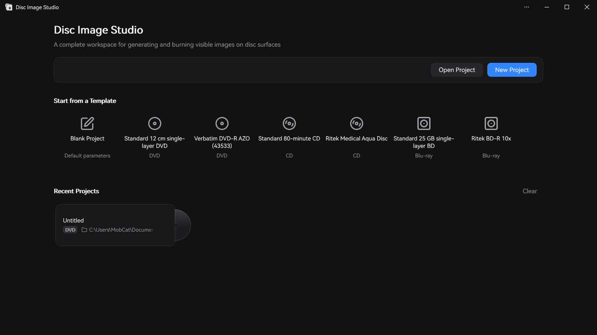
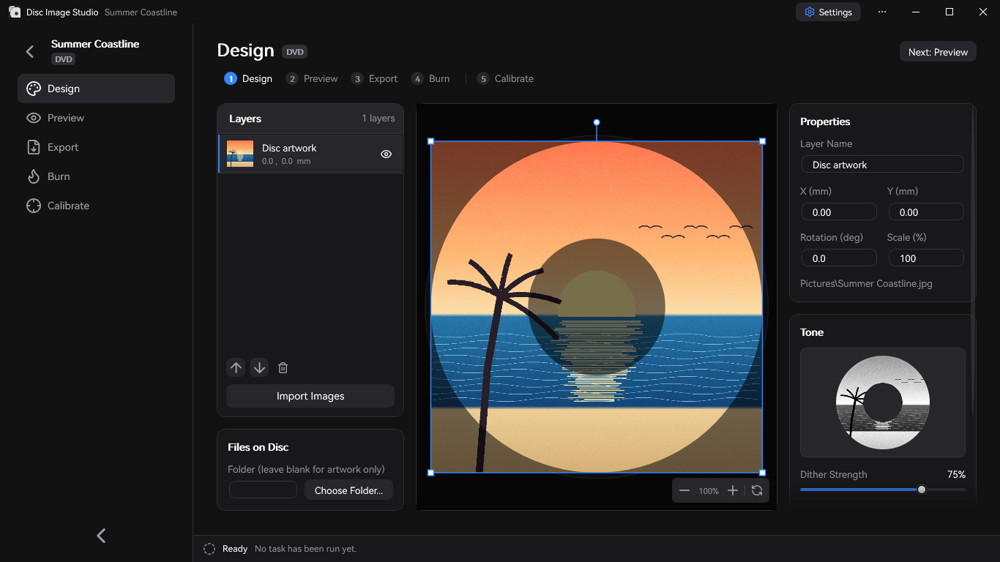
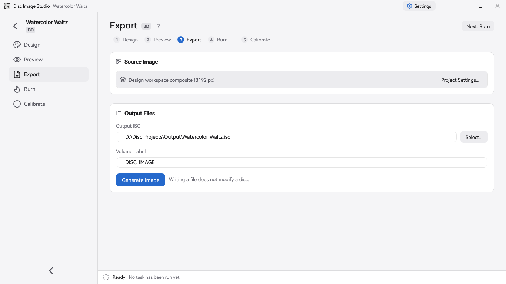

<div align="center">

**English** | [简体中文](README.zh-CN.md) | [繁體中文](README.zh-TW.md) | [日本語](README.ja.md) | [にほんご（ひらがな）](README.ja-Hira.md)


<h2>The complete tool for generating and burning visible images on disc surfaces</h2>

Disc Image Studio is a Windows tool for generating and burning disc-surface images. It lets you etch a pattern visible to the naked eye onto **any** DVD / CD / Blu-ray disc using **any** recorder.


[](LICENSE)

</div>

---

## Sample results


---

## Overview

Disc Image Studio converts an image into data that satisfies the physical-layer constraints of CD, DVD and single-layer BD-R media, so that burning it makes the pattern visible to the naked eye on the disc surface.

## Translation notes

The translation of this project was done back at v1.3.3 however an hour after I found this project and started on this work, v1.3.4 came out adding translations as well.
So this project is kinda pointless now. I'll keep it maintained a little but translations can be done by anyone now with simple edits to json files.

## Interface preview







---

## Quick start

Download the release EXE from [GitHub Releases](https://github.com/JiaFeiMiao-K-Cat/DiscImageStudio/releases) and run it directly after extracting; the EXE already includes the .NET runtime.

### 1. Create a project

On the home page, choose CD, DVD or Blu-ray, specify an output location, and create the project.

### 2. Design the disc surface

Import images on the Design page, arrange them with layers, and adjust dithering, gamma, brightness and grayscale levels in the Tone panel on the right.

### 3. Preview and export

Check the disc projection on the Preview page, generate ISO / RAW / WAV+CUE on the Export page, or write straight to a blank disc with instant burning.

Instant burning is experimental, so use only test media you can afford to scrap.

## Features

### Disc data generation

- **CD support**: works with any CD. You can export a WAV audio track with a format header plus a matching CUE sheet, which cdrecord, ImgBurn and similar burning tools accept; exporting a RAW audio track is also supported. See [CD burning compatibility](docs/CD_AUDIO_COMPATIBILITY.md).
- **DVD support**: works with any DVD. You can export an ISO image.
- **Blu-ray support**: works with any single-layer 25 GB BD-R, with either artwork only or UDF 2.01 files. See [ADDING_BLURAY.md](docs/ADDING_BLURAY.md).
- **Files on disc**: for CD / DVD / Blu-ray you can pick the folder to include and its inner-ring / outer-ring position on the Design page, or adjust it on the Export page; the setting is saved with the project.
- **File-area preview**: for hybrid discs, Design Projection and Image Readback mark the file area (including the file system) in yellow.
- **Media gray scheme**: CD and DVD both use two black and white levels; CD uses `0D / AA` and DVD uses `A5 / 92` in the scrambled domain. See [PHYSICAL_MODEL_AUDIT.md](docs/PHYSICAL_MODEL_AUDIT.md).
- **Grayscale dither tool**: a standalone program that can process a source image into a two-level `0/255` black and white PNG; it supports opening or dragging in a source image, side-by-side preview and lossless PNG export. See the [usage and build notes](tools/FourLevelDither/README.md).
- **Disc presets**: parameters for several brands of disc are built in, covering CD / DVD / BD. You can also contribute your own calibrated data; see the [preset maintenance notes](docs/DISC_PRESETS.md).

### Calibration assistant

Disc Image Studio provides an intelligent and precise calibration assistant. Compared with calibration by eye, the assistant raises the precision of the disc physical parameters it can determine from 10<sup>-6</sup> to 10<sup>-14</sup>. Before calibration a constant track pitch is assumed, so the radial arms of the cross visibly bow; after regenerating and burning with the cubic track-pitch parameters from the calibration assistant, the arms come much closer to true radial lines.

| Before calibration · constant track pitch | After calibration · cubic track pitch |
| --- | --- |
|  |  |
| `P20261004-133519.jpg` | `P20261004-135416.jpg` |


The workflow and parameters are described in the [calibration assistant notes](docs/CALIBRATION.md).

### Burning

- **Image file output**: export a complete ISO / RAW file and burn it manually with suitable burning software.
- **Instant streaming burn (experimental)**: CD, DVD and BD-R are generated and burned at the same time without saving a complete image; BD-R uses MMC sequential writing.
- **Do not use non-blank media!**

### Application modes

- Multilingual interface: click the "Settings" button in the top-right corner and choose English, 简体中文, 繁體中文, 日本語, にほんご（ひらがな） (hiragana-only Japanese) or Use System Setting under "General → Language", then save and restart the app. Language and theme both follow the system by default, and explicitly saved choices are kept. With Use System Setting, Traditional Chinese system locales (`zh-TW`, `zh-HK`, `zh-MO`, `zh-Hant`) get Traditional Chinese, other Chinese locales get Simplified Chinese, Japanese locales get Japanese, and every other locale gets English.
- Dual entry point: with no arguments it opens the GUI; with arguments it runs the unified command line.
- Modular: CD, DVD and Blu-ray plug in through `IOpticalDiscModule` with a unified command catalog and job contract; see the [architecture notes](docs/ARCHITECTURE.md).

## System and device requirements

- Windows 10 2004 (20H1, build 19041) or later, or Windows 11.
- Build: .NET 10 SDK (`global.json` pins 10.0.x); a self-built framework-dependent GUI needs the .NET 10 Windows Desktop Runtime. The release EXE already includes the runtime, so no separate .NET install is needed.
- Instant burning needs a CD / DVD / BD recorder that Windows recognises plus blank media; BD-R needs a blank single-layer disc that supports sequential recording.

## Building and running

```powershell
dotnet build DiscImageStudio.slnx --configuration Release
dotnet run --project src/DiscImageStudio.App --configuration Release
```

Build regression checks:

```powershell
dotnet run --project src/DvdImageSolver --configuration Release -- selftest
dotnet run --project tests/DiscImageStudio.ArchitectureTests --configuration Release
```

Version rules, CI EXE builds, release draft checks, and the MSIX packaging and signing flow are covered in the [release guide](docs/RELEASING.md).

## Command line

With no arguments the unified program opens the GUI; with arguments it acts as an automation tool:

| Command | Description |
| --- | --- |
| `solve` | Generate a DVD image using a fixed fast texture map (CW), with optional dither mixing for black and white texture |
| `encode` | Encode a single DVD ECC block into NRZI channel levels |
| `calibrate` | Calibration projection: sample the DVD source image with the generated geometry and map it onto the disc using the measured geometry |
| `simulate` | Simulate readback of a generated DVD ISO using the measured radii |
| `selftest` | Run the DVD engine's deterministic regression self-test |
| `cd-generate` | Generate a WAV + CUE / RAW audio track when there are no files on disc; generate a CD data disc ISO when `--data-dir` is given |
| `cd-preview-warp` | Calibration projection: project a CD source image using the measured geometry |
| `cd-preview-track` | Render an existing WAV or RAW CD-DA audio track with the calibration geometry (readback simulation) |
| `bd-generate` | Generate a complete BD-R ISO and write the `<iso>.json` sidecar |
| `bd-info` / `bd-probe` / `bd-encode` | Dump BD parameters, probe raw payload, or diagnose a single ECC cluster |

See the matching document for each command's full parameters.

## Source layout

```text
src/DiscImageStudio.Core/    Media-agnostic module contracts, project/preset models, job and command catalog
src/DiscImageStudio.Imaging/ Image pre-processing and dithering helpers shared by CD/DVD/BD
src/DiscImageStudio.Burning/ Windows IMAPI2 device enumeration, stream buffering and safe-burn layer
src/DiscImageStudio.Cd/      CD-DA generation core and the CD module
src/DiscImageStudio.Dvd/     DVD engine adapter module
src/DiscImageStudio.BluRay/  BD-R geometry, 17PP/ECC, 3T/6T mapping, streaming generation and ISO
src/DiscImageStudio.Iso/     UDF 2.01 / ISO9660 writers
src/DiscImageStudio.App/     WPF GUI, unified command line and store assets
src/DvdImageSolver/          Isolated DVD encoding/solving engine
tests/                       Architecture regression tests without a third-party test framework
packaging/                   MSIX manifest and packaging scripts
tools/                       Standalone helper tools and asset generation scripts
docs/                        Architecture, engine, preset and release documents
```

## Documentation

| Document | Contents |
| --- | --- |
| [ARCHITECTURE.md](docs/ARCHITECTURE.md) | Module abstraction, layer boundaries and extension rules |
| [LOCALIZATION.md](docs/LOCALIZATION.md) | Interface language settings, system language fallback and translation resource maintenance |
| [DVD_ENGINE.md](docs/DVD_ENGINE.md) | Conventions, encoding chain and self-test coverage of the DVD NRZI image constraint solver |
| [CD_AUDIO_COMPATIBILITY.md](docs/CD_AUDIO_COMPATIBILITY.md) | CD audio track formats, byte order and ghosting troubleshooting |
| [ADDING_BLURAY.md](docs/ADDING_BLURAY.md) | Blu-ray module physical model, generation/burn chain and extension points |
| [DISC_PRESETS.md](docs/DISC_PRESETS.md) | Layered JSON format and merge rules for editable disc presets |
| [CALIBRATION.md](docs/CALIBRATION.md) | Photo rectification (tracing the disc's physical outer edge and centre-hole edge), curve calibration and DVD cubic track-pitch fitting |
| [PHYSICAL_MODEL_AUDIT.md](docs/PHYSICAL_MODEL_AUDIT.md) | Review of the CD / DVD generation physical model |
| [VALIDATION.md](docs/VALIDATION.md) | Local validation record for each round of builds, regression and real-disc testing |
| [RELEASING.md](docs/RELEASING.md) | GitHub Release, MSIX packaging, signing tests and store submission flow |
| [CHANGELOG.md](CHANGELOG.md) | Version change log |

## Reference standards

The implementation and physical models of Disc Image Studio mainly follow these specifications:

| Media | Standard and version | Scope adopted by this project |
| --- | --- | --- |
| CD-R | [ECMA-394, 1st edition, December 2010](https://ecma-international.org/publications-and-standards/standards/ecma-394/) — *Recordable Compact Disc Systems CD-R Multi-Speed* ([official PDF](https://ecma-international.org/wp-content/uploads/ECMA-394_1st_edition_december_2010.pdf)) | CD-R media, multi-speed recording and CD-DA compatibility; this project generates CD-DA audio tracks. |
| DVD common format / DVD-ROM | [ECMA-267, 3rd edition, April 2001](https://ecma-international.org/publications-and-standards/standards/ecma-267/) — *120 mm DVD – Read-only disk* ([official PDF](https://ecma-international.org/wp-content/uploads/ECMA-267_3rd_edition_april_2001.pdf)) | DVD data frames, ECC, EFMPlus encoding and the Annex G conversion table; media rules for recordable discs follow ECMA-359. |
| DVD-R | [ECMA-359, 1st edition, December 2004](https://ecma-international.org/publications-and-standards/standards/ecma-359/) — *80 mm (1,46 Gbytes per side) and 120 mm (4,70 Gbytes per side) DVD Recordable Disk (DVD-R)* ([official PDF](https://ecma-international.org/wp-content/uploads/ECMA-359_1st_edition_december_2004.pdf)) | Geometry, sectors, error correction and encoding for single-layer DVD-R; the standard covers single-sided and double-sided media, and double-sided is not the same as dual-layer. |
| BD-R | [ISO/IEC 30190:2021, 3rd edition, January 2021](https://www.iso.org/standard/80770.html) — information interchange and storage specification for 120 mm single-layer (25.0 GB) and dual-layer (50.0 GB) recordable BD | The experimental mode uses the track, sector layout, error correction and encoding of single-layer 25 GB; dual-layer discs are not supported yet. |

The common CD encoding also follows [ECMA-130, 2nd edition (CD-ROM, 1996)](https://ecma-international.org/publications-and-standards/standards/ecma-130/).

## Burning and media safety

- Disc Image Studio installs no drivers or services; instant burning uses the IMAPI2 that ships with Windows and rejects non-blank media.
- Instant burning has some real-disc feedback but still has limited coverage across devices, media and burn paths, so it is experimental: use only test media you can afford to scrap. Interrupting a burn, losing power, or generating too slowly can still ruin the disc!
- The visible result depends on the disc, recorder, firmware and write strategy.
- For hybrid folders the directory is scanned and the layout fixed before burning starts; if a source file changes size in the meantime the job stops safely, but a disc that has started writing may still be ruined.
- Sequential BD-R writing provides no spare-area remapping; after an interruption the same disc usually cannot be written again.

## Privacy and security

- Disc Image Studio does not go online, upload files or collect telemetry; see the [privacy policy](PRIVACY.md).
- If you find a security issue, please do not disclose it in a public issue; use GitHub's private reporting as described in the [security policy](SECURITY.md).

## Contributing

Bug reports and code contributions are welcome. Setup, module-boundary rules, test requirements and the Pull Request flow are described in the [contributing guide](CONTRIBUTING.md).

## License

The project is released under the [GNU GPL v3.0 or later](LICENSE) (`GPL-3.0-or-later`). The CD interleaving implementation includes code ported from CDImage and modified, so the overall distribution stays under a compatible GPL grant; distributing binaries or modified versions carries the usual corresponding-source requirements. Third-party fonts and components keep their own licences, described in the [licence notes](LICENSE-NOTICE.md) and [third-party notices](THIRD-PARTY-NOTICES.txt); the app's About page also shows the full texts offline.

## Acknowledgements

Thanks to [arduinocelentano's CDImage project](https://github.com/arduinocelentano/cdimage), which demonstrated how to form a visible image on the disc surface by generating CD audio tracks. This project's CD interleaving implementation is ported from its related code and further modified, and the idea of drawing on a CD surface was inspired by it. The work of CDImage's original author and contributors provided an important foundation for this project.

---
