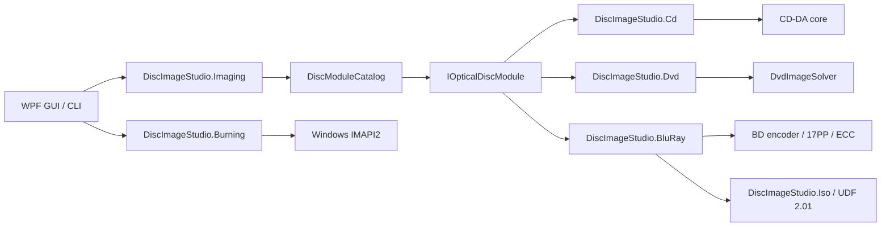

# Architecture

## Goals

The core goal is that the application shell does not depend on any one optical encoding. CD, DVD and Blu-ray differ in physical modulation, error correction, sector organisation and file system, so what is shared is the job lifecycle and product capability, not a mistaken "universal encoder" base class.

## Core contracts

`DiscImageStudio.Core` references neither WPF, CD, DVD nor any concrete encoder, and targets `net10.0`.

- `IOpticalDiscModule`: the module execution boundary.
- `DiscModuleDescriptor`: module ID, media family, cancellation capability and command metadata.
- `DiscCommandDescriptor`: command, capability and option definitions, which a future dynamically generated interface could consume.
- `DiscJobRequest`: the unified command and parameter carrier.
- `DiscJobProgress`: media-agnostic progress, stage, completed amount and elapsed time.
- `DiscJobResult`: exit code, summary and output paths.
- `DiscModuleCatalog`: command routing, duplicate-command checks and module execution.
- `ToneProfile` / `ToneDither`: the tone model shared by CD/DVD/BD (dither strength, grayscale levels, brightness, sRGB linearization) plus a deterministic dither phase. CD/DVD dither over logical byte indices, so after CD delayed interleaving it can still be reproduced in the preview; BD quantises once at source-image resolution, and generation, burning and preview share the same binary raster.

All three `OpticalDiscFamily` values (`CompactDisc`/`Dvd`/`BluRay`) are implemented; project, presets, design, preview, export, burn and calibration all branch on these three media families.

Disc presets live in Core's single `disc-presets.json` (schema 4): the `cdPresets`, `dvdPresets` and `bluRayPresets` groups, each with its own disabled list. Reading an older schema 2/3 file injects the built-in BD templates and upgrades on the next save.

## Project model and shell

`DiscImageStudio.Core.ProjectJsonStore` owns `.discproj` (UTF-8 JSON, schemaVersion 2): the project name, the media family (CD/DVD/BD), the geometry (CD r0/r1/sectors; DVD plus cubic track-pitch coefficients; BD requiring 32-sector alignment, single-layer capacity and ≤60 mm), the layer list, the output configuration, an optional `tone` section, an optional `bluRay` polarity section, the calibration record path, and a thumbnail rendered at save time. A missing `tone` section means the legacy hard threshold; schemaVersion 1 CD/DVD files are read and then written back as version 2. BD's `bluRay.invertMapping` exists only in BD projects, and a CD/DVD file carrying that section is rejected. Both reading and writing validate and then atomically replace through a temporary file, with the same rules as the preset JSON. Layers reference images by absolute path and no assets are collected.

The shell is a workspace model: a start page (no sidebar, offering new/open, template cards and recent projects) plus five project workspaces — Design / Preview / Export / Burn / Calibration (the `Workspace` enum, whose order is also the sidebar order). Each workspace is one view onto the same project rather than a separate flow of its own: they share a single `DiscParametersState`, `ProjectSession` fills it from the document when a project opens and captures it back into the document when saving, and the bindings from preview, export, burn and calibration to that state are therefore fully decoupled from the project lifecycle. The dirty flag tracks only the state properties that are written into the project file.

The main window's custom chrome is constrained by `WindowWorkArea`: it sets the maximum position/size in `WM_GETMINMAXINFO` from the current monitor's physical work area (including taskbar, negative-coordinate monitors and differing DPI), and recomputes the minimum size when the window moves between monitors or the resolution or DPI changes. It no longer relies on `SystemParameters.WindowResizeBorderThickness`, which only reflects the system primary monitor's margins.

Workflow visibility is carried by two shell facilities: the **stage bar** (`StageBar`) under the page header's title row (Design → Preview → Export → Burn │ Calibration, with the current stage highlighted in brand blue, completed stages ticked and dimmed, and any stage clickable to jump straight there) and the "Next" button in the page header's right slot. The window wires both to `NavigateTo`: it holds every page instance and pushes `CurrentWorkspace` into each page's stage bar when the workspace changes, so the workflow is visible and reachable on every page without depending on the sidebar.

Workspace pages share their skeleton and panel language: `MonitorCard` (a monitor card: header icon + title + subtitle + action slot, body content, optional status footer) carries the preview result and the calibration photo stage; `StepCard` (a numbered step card: state chip Not Started / In Progress / Complete + collapsible body) carries the calibration page's three-step inspector, expanding the active step and collapsing the rest; `VisibilityGate` (shows or hides content from a single boolean) unifies the per-page media-family/mode branching and replaces the private DataTrigger styles each view used to have; `PathField` and `SourceChip` collapse the recurring path row and source strip into a single implementation; `EmptyStateCard` (icon + one sentence + jump action) unifies the empty-state guidance on every page. Card headers come in two tiers: monitor/list containers use the `CardHeaderBandStyle` colour band (MonitorCard, the Design page layer card), while form cards keep a flat title; both use a 15 px icon. `SourceChip`'s `Actions` slot carries the "go to owner" button, so the "read-only summary + jump" row looks identical on every page. Density rules: sidebar and inspector panels always use the Compact family (36 px), the main stage and primary action buttons use the standard height (44 px), and both side panels share the `SidePanelWidth` (280) token.

The sidebar carries an icon on every workspace entry and becomes an icon rail when collapsed to 72 px (group headers hide in the narrow state and child items list directly); there is no longer a collapsed icon list that needs a second click to expand. "Settings..." and "About..." are gathered into the "…" application menu to the left of the title bar's minimise button (`TitleBar.ShowAppMenu` + `AppMenuRequested`, with Ctrl+, going straight to Settings); it opens both on the home page and with a project open, and the sidebar no longer keeps an "About" entry at the bottom.

`DesignView` and `CalibrationView` both switch layout on page width: in a wide window the workspace is pinned to the viewport height (the pinned value is recomputed as the outer `ScrollViewer`'s viewport/content size changes, so transients such as a zero viewport on first layout or a one-pixel DPI rounding difference cannot leave the page in a meaningless scrolling state); in a narrow window the side column folds below the stage and the whole page scrolls (the Design page switches below 900 px page width, the Calibration page below 990). In the narrow layout the Design page gives the canvas a fixed height so it cannot be squeezed to uselessness when three columns crowd together. The Design page's right column is two auto-height cards, "Properties" and "Tone", scrolled by that column's own `ScrollViewer`; below 900 px page width the column folds under the layer card and scrolls with the page. The tone module (`TonePanel`) is a separate UserControl: inside the 280 px right column it uses a thumbnail disc plus single-column controls, and in the full-width right column after folding it switches to a large disc on the left with controls on the right (it has its own name scope, so page-level `x:Name` cannot reach into it).

The Preview page's parameter panel is supplied by `PreviewInspectorViewModel`: it projects the three CD, DVD and BD parameter sets onto the same set of rows (`ArtifactPath`, `ArtifactLabel`, `MeasuredInnerRadius`, `PreviewSize`, `SamplesPerSector`, …). There is no in-page media-family switch — projection preview follows the project's media family strictly and is set by `SetDiscType` when the project opens, and the inspector merely re-points that row set at the current family instead of swapping in a second copy of the panel. The read-only group (generation geometry) is presented as text composed by `DiscParametersState` with a jump to its owner; Image Readback additionally offers a "Deinterleave" toggle bound directly to the shared `CdInterleave`, so an external audio track (with no sidecar) is read back using the interleaving the user declares; BD has no per-sector sample item. Writes from the preview's own group (measured radii and track pitch, preview quality) land on the currently displayed media family and are folded into the "Measurement & Quality" expander. BD's Image Readback reads the matching sidecar automatically and restores the total sector count, the radii, the artwork start and end, the polarity and the tone; an external ISO without a sidecar is still read back using the current project geometry.

Parameter ownership and progressive disclosure:

- **Generation geometry** (r0, r1, sectors, and the three DVD track-pitch terms) is edited only in the Project Settings dialog. Other workspaces show a read-only summary (`GeometrySummary`) and an "Edit..." shortcut, and no longer each provide their own editor.
- **Disc presets** are a shortcut to generation geometry and belong to the same place: a new project chooses one through the template list on the left (which lists every non-manual preset in the catalog). The Project Settings dialog no longer shows the media family or preset selection — the family is fixed with the project — and the bottom of the parameter area offers "Save These Parameters as a Preset", which appends the current fields to the user preset JSON (a separate window confirms the name, and the catalog refreshes immediately after saving).
- **Delivery parameters split by destination**: the Export workspace only writes files (output paths, CUE, interleaving, ISO/data folder/volume label), and the Burn workspace only writes discs (content to burn, recorder and speed). Both consume the same export-quality composite, so material verified as a file is the material written to the disc; the CD/DVD being burned is derived from the source (the project's media family or the calibration pattern's), with no switch that can be flipped to the wrong side. The "Content to Burn" segmented control on the Burn page is the page-level source choice (the same pattern as Design Projection / Image Readback on the Preview page): choosing the project composite gives a source summary directly, while choosing the calibration pattern links to the Calibration workspace; the source choice is no longer nested inside the destination switch.
- **Tone** is a generation parameter and belongs to the Design workspace's right column: dither strength (0–100%, 75% for new projects), sRGB linearization (gamma), the CD grayscale levels (2/4 levels; DVD/BD are fixed at 2) and brightness (±64) are written into the project's `tone` section, and generation, streaming burn, readback and calibration projection all share the same `ToneProfile`. BD additionally has a 3T/6T polarity switch, which is the independent `bluRay.invertMapping` in the data and is not stuffed into `ToneProfile`. The in-module disc preview projects the current composite with the same mapping and updates as the sliders move; the Export page keeps only output options and points out that tone lives on the Design page, and the Preview page does not edit it again.
- **Preview-only parameters** (measured radii, output size, samples per sector) stay on the Preview page because they describe inspection behaviour rather than project parameters. When a project opens, the measured geometry follows the project geometry first, so Design Projection is neutral by default; only after the user enters measured values are the differences between the two geometries shown, and only the calibration workflow writes them back on its own initiative.

The Design workspace (`DesignViewModel` + `DiscDesignCanvas` + `DesignComposer`) maintains the layer stack: layers are stored in panel order (top is index 0, and the canvas draws bottom-up, matching composition order), the canvas renders in a millimetre coordinate system centred on the disc and supports dragging, corner scaling and rotation handles, and the layer rows are a selectable list kept in two-way sync with the canvas and the properties panel. After a 450 ms debounce, layer edits are rendered by `DesignComposer` into a square composite (2048 px for preview, 8192 px for export): the square's centre is the disc centre and its side corresponds to 2 × the canvas outer radius (fixed at 57.5 mm for CD, the generated outer radius for DVD/BD). The composite is written into the state's source image path and becomes the common input for export and preview; the generation CLI and pipeline know nothing about it. Both delivery paths, Export and Burn, use the export-quality 8192 px composite, so the material verified in preview is the material written to the disc. The page header's "Next" runs Design → Preview → Export → Burn, and Calibration is reached through the sidebar or the link on the Burn page.

The design language lives in `Themes/Tokens.xaml` (colours, semantic colours, corner radii including `RadiusChip`/`RadiusPanel`/the mirrored card head and foot arcs, control heights, `SidePanelWidth`, page padding, overlay shadows, and the canvas palette) and in `Themes/Controls.xaml` (text hierarchy, button families, input controls, list rows, disclosure panels, the `DangerCard` warning card, and the monitor and step card templates). Code-side animation always uses the three durations in `Controls/Motion.cs`, and custom canvases always take colours and draw the disc body through `Controls/DiscTheme.cs` and `Controls/DiscRenderCore.cs` instead of each embedding its own palette. A derived style in `Controls.xaml` that is based on an implicit style (`BasedOn="{StaticResource {x:Type X}}"`) must be declared after that implicit style: a forward reference does not raise an error, it silently falls back to the built-in Windows style and the control appears in the light system look. A panel that must host page-named content (such as `MonitorCard`) is built as a templated custom control rather than a UserControl: a UserControl isolates its content into its own name scope, so page elements with an `x:Name` will not compile and snapshot hooks and canvas wiring cannot reach them.

Theme switching is instant: `Themes/Palette.Light.xaml` overrides every colour and brush key in `Tokens.xaml`, and `Services/ThemeResolver` inserts or removes the light layer at index 1 of the merged dictionaries, so windows need not be rebuilt. Views must therefore reference palette keys with `DynamicResource` (`StaticResource` freezes the dark value at load time, and `ThemePaletteTests` catches it); controls that take colours in code (`SideNavItem`, `SegmentedControl`, `DiscDesignCanvas`, `CalibrationPhotoCanvas`, `JobDock`, `HelpHint`) subscribe to `ThemeResolver.Changed` and re-read the tokens. The system theme is read from `HKCU\...\Themes\Personalize\AppsUseLightTheme`.

Application settings are persisted by `Services/AppSettingsStore` to `%LOCALAPPDATA%\DiscImageStudio\settings.json` (camelCase, string enums, atomic replacement through a temporary file): theme, default project location and cache location. A missing, corrupt, or higher-schemaVersion file falls back to defaults, and manually broken paths are discarded in `AppSettings.Normalize`; settings are never written into `.discproj`. The default project location only affects the starting directory of the New Project dialog and falls back to the system Documents folder when it does not exist. `Services/TempFiles` holds the configurable cache directory (`LivePreviewDirectory`), where design composites, thumbnails and preview images are written; switching it affects only new jobs, and clearing the cache deletes by filename allow-list (`design-composite-*`, `design-tone-*`, `design-thumbnail.png`, `cd/dvd/bd-live-*` and their `.png.json` sidecars) and never removes directories, projects or exported files. The settings window edits only a copy before saving, and cancelling or pressing Esc discards every edit.

## Image pre-processing layer

`DiscImageStudio.Imaging` sits between the interface and the media encoding modules and currently carries only `RingImageQuality`: the constant production generation size (8192 px) for the Design page composite, shared by design composition, export and readback. Laying an image out on the disc (scale, centre, crop to the content ring) is done by the Design page's `DesignComposer` on the millimetre canvas, and export/burn/preview consume the composite directly, so there is no longer a separate pre-processing step.

## Streaming burn layer

CD's `OpticalBurnRequest.ProduceContent` explicitly requires headerless 44.1 kHz, 16-bit, two-channel little-endian PCM, and `ContentLength` counts only the audio data. The CD generator's default headerless stream keeps the legacy big-endian output, and the shell explicitly selects `CdAudioByteOrder.LittleEndian` when calling IMAPI; the conversion happens at the whole-sector output after delayed interleaving completes. File generation picks the format from the `.wav` / `.raw` suffix: WAV uses the same little-endian audio data plus a 44-byte RIFF header and a matching WAVE CUE, while legacy RAW stays big-endian. The Windows RAW image builder was measured to pass bytes through unchanged and does not correct byte order. See [CD burning compatibility](CD_AUDIO_COMPATIBILITY.md).

`DiscImageStudio.Burning` is responsible only for Windows IMAPI2 device enumeration, media checks, the COM `IStream` adapter, the bounded 64 MiB memory buffer (pre-filled with 32 MiB before burning starts) and the burn lifecycle. Automatic speed re-reads the current disc's write configurations when a CD/DVD burn actually begins and picks the lowest value, while a manual selection keeps its value; when a device reports no speeds it uses the burning interface's conservative fallback. The CD/DVD generators still own the media format: CD produces 2352-byte audio sectors in order and the DVD fast algorithm produces 2048-byte data sectors in order. The recorder pulls these blocks on demand, so no complete image ever appears on disk. The original file-output entry point does not go through this layer, so a failure there cannot damage the original workflow.

DVD hybrid folder mode generates in two ordered phases: the first phase scans the directory and fixes the ISO9660/Joliet metadata, the file extents and the artwork start and end LBAs; the second phase emits in the planned disc order, which in inner-ring mode is "metadata → files → artwork" and in outer-ring mode is "metadata → artwork → files". Artwork is aligned to 16-sector ECC blocks. The layout plan stores only metadata and never caches file content, so non-seekable streams are supported.

BD-R reuses the same burn contract: `BluRayIsoGenerator` writes UDF 2.01, the artwork region and the disc-end backup metadata in a single forward stream; in outer-ring mode the whole file partition moves ahead of the trailing backup area, with the artwork always 32-sector aligned and outside the partition. The Burn page feeds that stream straight into an MMC sequential-write session without ever writing a complete 25 GB image to disk. BD provides no spare-area remapping; after an interruption the disc usually cannot be written again.

`ProjectOutputs.FilesAtOuterRing` is an optional field defaulting to `false`, and DVD/BD each synchronise export, preview and burn through the shared parameter state. In GUI previews the file area is highlighted in yellow using the artwork start/end boundary and includes the file-system reservation it needs; that colouring never reaches the generator. Existing output relies on the fixed range in its sidecar and does not re-guess the layout from the current directory.

## Module boundaries

### CD

`DiscImageStudio.Cd` owns CD geometry, image sampling, RAW output and delayed interleaving. It implements cancellation and converts byte progress into the unified `DiscJobProgress`.

### DVD

`DiscImageStudio.Dvd` is a thin adapter. It handles only metadata, routing and result normalisation, then calls the isolated `DvdImageSolver`. The DVD engine's original parameters and self-test are unchanged.

### Blu-ray

`DiscImageStudio.BluRay` owns BD geometry, 17PP, EDC/Reed-Solomon/LDC-BIS, the 3T/6T run-count mapping, streaming generation and the ISO plan, and references `DiscImageStudio.Iso` to write UDF 2.01. It exposes jobs to the GUI only through the Core contracts and neither references nor modifies CD/DVD internal types. BD's `ToneProfile` quantises at source-image resolution, and `BluRayRunLengthMapping` only applies the 128 threshold and the polarity swap; during generation a `bd-r-image-v1` sidecar is written next to the ISO recording the sectors, radii, artwork start and end, polarity, tone and UDF timestamp.

## Extension rules

1. Module IDs and command names must be globally unique, and the catalog rejects conflicts at start-up.
2. Modules must not read state from GUI controls; all input arrives through `DiscJobRequest`.
3. Modules must not show windows directly; logs, progress and results are returned through the contracts.
4. If a low-level algorithm cannot be cancelled safely, `SupportsCancellation` must be `false`.
5. Media-specific formats stay in the dedicated module; only stable, genuinely shared concepts enter Core.
6. A new module must add catalog routing tests and a minimal-output smoke test.
